# Shop: system documentation

Generated DATE from 4 OpenAPI contracts. Links marked *suggested* are inferred from shared IDs and model names; confirm them, or declare real calls with `x-calls` (see the appendix).

**Contents:** [Overview](#overview) · [System map](#system-map) · [How the system fits together](#how-the-system-fits-together) · [Flows](#flows) · [Services](#services) · [Data models](#data-models) · [Consistency checks](#consistency-checks) · [Appendix: declaring links](#appendix-declaring-links)

## Overview

| Service | Version | Spec | Base URL | Auth | Operations | Tags |
| --- | --- | --- | --- | --- | --- | --- |
| [Customer Service](#customer-service) | 1.4.0 | OpenAPI 3.0.3 | `https://api.shop.example.com/customers/v1` | Bearer token | 3 | customers |
| [Order Service](#order-service) | 2.1.0 | OpenAPI 3.0.3 | `https://api.shop.example.com/orders/v2` | Bearer token | 4 | orders |
| [Payment Service](#payment-service) | 1.0.3 | OpenAPI 3.0.3 | `https://payments.internal.shop.example.com/v1` | API key X-Internal-Key in header | 3 | payments |
| [Notification Service](#notification-service) | 0.9.0 | Swagger 2.0 | `https://api.shop.example.com/notifications/v1` | Basic auth | 2 |   |

## System map

Solid arrows are calls declared with `x-calls`. Rounded nodes are events. Dashed arrows are suggested references; dotted lines join services that share a model name. Grey dashed boxes are services named in `x-calls` whose contract wasn't loaded.

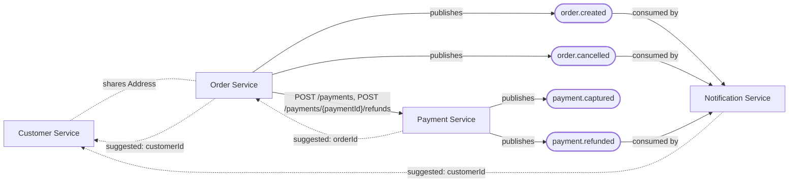

## How the system fits together

The system has 4 services exposing 12 operations. The contracts declare 1 service-to-service call link and 4 events; 3 more links are suggested from shared IDs.

- **Customer Service** (v1.4.0) exposes 3 operations on customers. Owns customer profiles and their saved addresses. Callers authenticate with Bearer token.
- **Order Service** (v2.1.0) exposes 4 operations on orders. Takes orders, charges them through Payment Service and announces them to the rest of the system. Callers authenticate with Bearer token. It calls Payment Service (POST /payments, POST /payments/{paymentId}/refunds). It publishes `order.created`, consumed by Notification Service. It publishes `order.cancelled`, consumed by Notification Service. It appears to reference Customer Service via `customerId` (suggested).
- **Payment Service** (v1.0.3) exposes 3 operations on payments. Charges cards and issues refunds. Internal only. Callers authenticate with API key X-Internal-Key in header. It is called by Order Service. It publishes `payment.captured`, with no subscriber in these contracts. It publishes `payment.refunded`, consumed by Notification Service. It appears to reference Order Service via `orderId` (suggested).
- **Notification Service** (v0.9.0) exposes 2 operations on notifications. Emails customers when their orders change. Callers authenticate with Basic auth. It consumes `order.created` from Order Service. It consumes `order.cancelled` from Order Service. It consumes `payment.refunded` from Payment Service. It appears to reference Customer Service via `customerId` (suggested).

### Events

| Event | Published by | Consumed by |
| --- | --- | --- |
| `order.created` | Order Service (POST /orders) | Notification Service |
| `order.cancelled` | Order Service (DELETE /orders/{orderId}) | Notification Service |
| `payment.captured` | Payment Service (POST /payments) | None |
| `payment.refunded` | Payment Service (POST /payments/{paymentId}/refunds) | Notification Service |

### Links to confirm

Contracts say what a service offers, not what it calls, so these links are guesses. Each one is a field that looks like the ID of a resource another service owns.

| From | To | Evidence | Status |
| --- | --- | --- | --- |
| Order Service | Customer Service | customerId in GET /orders, POST /orders, model NewOrder, model Order | Suggested |
| Payment Service | Order Service | orderId in POST /payments, model NewPayment, model Payment | Suggested |
| Notification Service | Customer Service | customerId in GET /notifications, model Notification | Suggested |

## Flows

### Place an order (Order Service)

Starts with POST /orders on Order Service and follows the calls and events its contract declares.

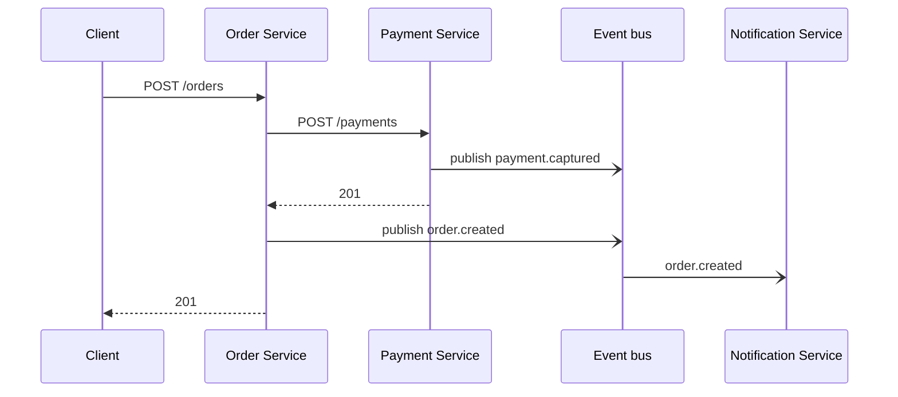

### Cancel an order (Order Service)

Starts with DELETE /orders/{orderId} on Order Service and follows the calls and events its contract declares.

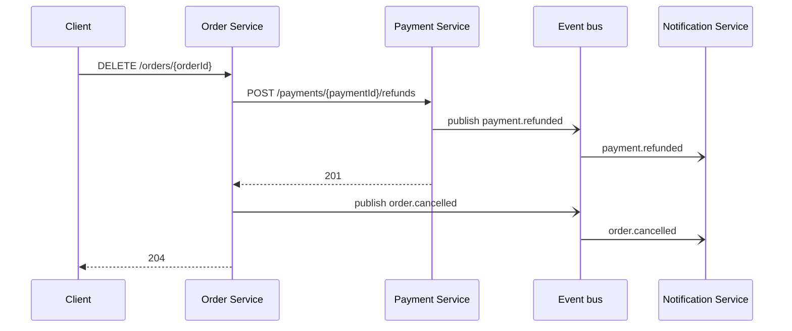

### Event: order.created

Published by Order Service. Consumed by Notification Service.

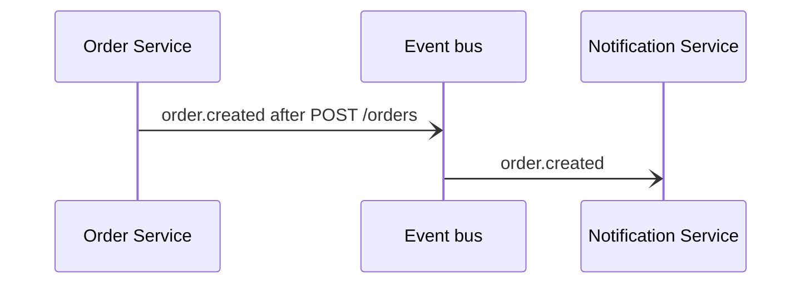

### Event: order.cancelled

Published by Order Service. Consumed by Notification Service.

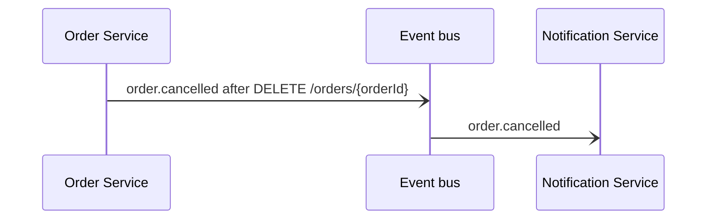

### Event: payment.captured

Published by Payment Service. Consumed by nobody.

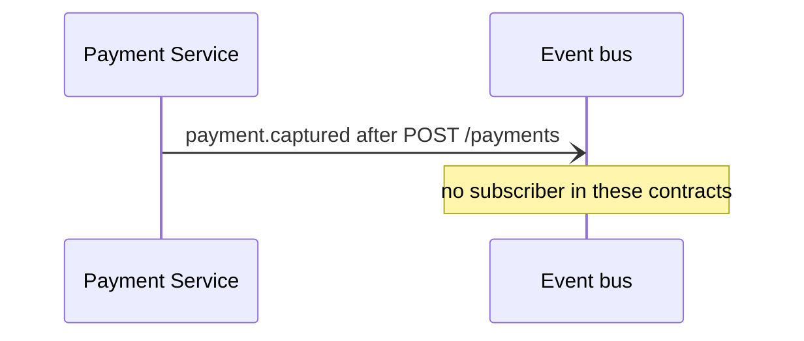

### Event: payment.refunded

Published by Payment Service. Consumed by Notification Service.

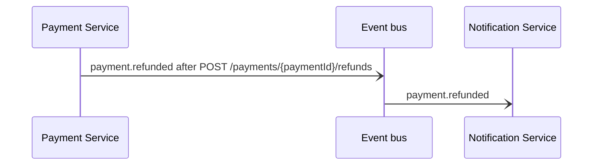

### Resource /customers (Customer Service)

Typical order of calls: Register a customer (POST /customers), then Get a customer (GET /customers/{customerId}), then Update a customer (PATCH /customers/{customerId}).

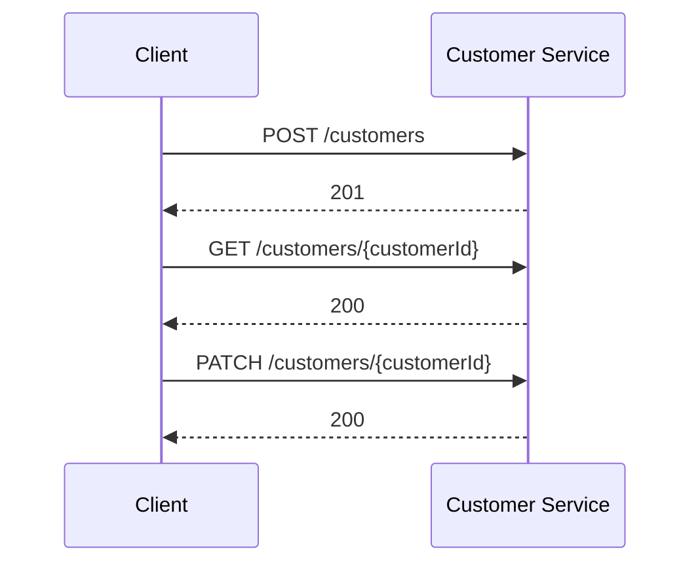

### Resource /orders (Order Service)

Typical order of calls: Place an order (POST /orders), then List a customer's orders (GET /orders), then Get an order (GET /orders/{orderId}), then Cancel an order (DELETE /orders/{orderId}).

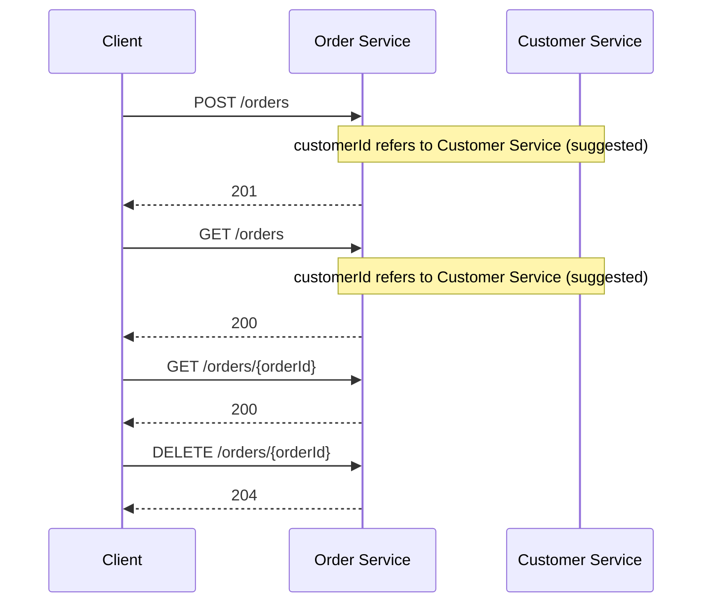

### Resource /payments (Payment Service)

Typical order of calls: Charge a payment (POST /payments), then Get a payment (GET /payments/{paymentId}).

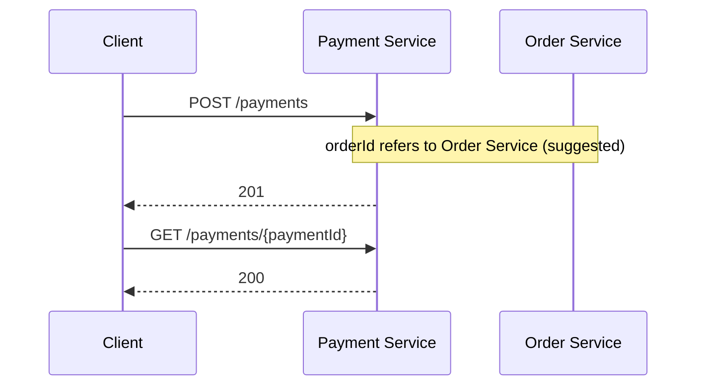

### Resource /notifications (Notification Service)

Typical order of calls: List notifications sent to a customer (GET /notifications), then Get a notification (GET /notifications/{notificationId}).

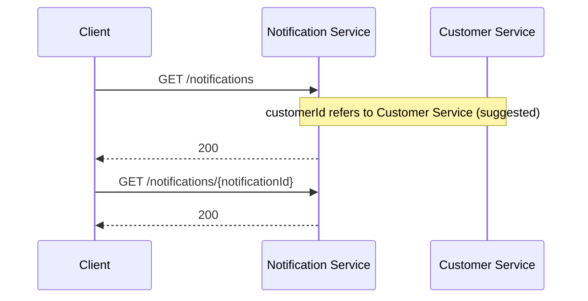

## Services

### Customer Service

Version 1.4.0 · OpenAPI 3.0.3 · Base URL `https://api.shop.example.com/customers/v1` · Auth: Bearer token

Owns customer profiles and their saved addresses.

| Method | Path | Summary | Auth | Success |
| --- | --- | --- | --- | --- |
| `POST` | `/customers` | Register a customer | Bearer token | `201` |
| `GET` | `/customers/{customerId}` | Get a customer | Bearer token | `200` |
| `PATCH` | `/customers/{customerId}` | Update a customer | Bearer token | `200` |

#### POST /customers · Register a customer

`createCustomer` · Auth: Bearer token · Tags: customers

**Request body** (`application/json`, required): NewCustomer

| Field | Type | Required | Rules | Description |
| --- | --- | --- | --- | --- |
| `name` | string | Yes | min length 1; max length 120 |   |
| `email` | string (email) | Yes |   |   |
| `address` | Address | No |   |   |

Example request:

```json
{
  "name": "Ada Lovelace",
  "email": "user@example.com",
  "address": {
    "line1": "12 Analytical Row",
    "city": "London",
    "postcode": "N1 9GU",
    "country": "GB"
  }
}
```

**Responses**

| Status | Description | Body |
| --- | --- | --- |
| `201` | Customer created | Customer |
| `400` | Invalid customer data | None |
| `409` | Email already registered | None |

Example 201 response:

```json
{
  "name": "Ada Lovelace",
  "email": "user@example.com",
  "address": {
    "line1": "12 Analytical Row",
    "city": "London",
    "postcode": "N1 9GU",
    "country": "GB"
  },
  "customerId": "3fa85f64-5717-4562-b3fc-2c963f66afa6",
  "createdAt": "2024-01-15T10:30:00Z"
}
```

#### GET /customers/{customerId} · Get a customer

`getCustomer` · Auth: Bearer token · Tags: customers

**Parameters**

| Name | In | Type | Required | Rules | Description |
| --- | --- | --- | --- | --- | --- |
| `customerId` | path | string (uuid) | Yes |   |   |

**Responses**

| Status | Description | Body |
| --- | --- | --- |
| `200` | The customer | Customer |
| `404` | No customer with that ID | None |

Example 200 response:

```json
{
  "name": "Ada Lovelace",
  "email": "user@example.com",
  "address": {
    "line1": "12 Analytical Row",
    "city": "London",
    "postcode": "N1 9GU",
    "country": "GB"
  },
  "customerId": "3fa85f64-5717-4562-b3fc-2c963f66afa6",
  "createdAt": "2024-01-15T10:30:00Z"
}
```

#### PATCH /customers/{customerId} · Update a customer

`updateCustomer` · Auth: Bearer token · Tags: customers

**Parameters**

| Name | In | Type | Required | Rules | Description |
| --- | --- | --- | --- | --- | --- |
| `customerId` | path | string (uuid) | Yes |   |   |

**Request body** (`application/json`, required): NewCustomer

| Field | Type | Required | Rules | Description |
| --- | --- | --- | --- | --- |
| `name` | string | Yes | min length 1; max length 120 |   |
| `email` | string (email) | Yes |   |   |
| `address` | Address | No |   |   |

Example request:

```json
{
  "name": "Ada Lovelace",
  "email": "user@example.com",
  "address": {
    "line1": "12 Analytical Row",
    "city": "London",
    "postcode": "N1 9GU",
    "country": "GB"
  }
}
```

**Responses**

| Status | Description | Body |
| --- | --- | --- |
| `200` | Customer updated | Customer |
| `400` | Invalid customer data | None |
| `404` | No customer with that ID | None |

Example 200 response:

```json
{
  "name": "Ada Lovelace",
  "email": "user@example.com",
  "address": {
    "line1": "12 Analytical Row",
    "city": "London",
    "postcode": "N1 9GU",
    "country": "GB"
  },
  "customerId": "3fa85f64-5717-4562-b3fc-2c963f66afa6",
  "createdAt": "2024-01-15T10:30:00Z"
}
```

### Order Service

Version 2.1.0 · OpenAPI 3.0.3 · Base URL `https://api.shop.example.com/orders/v2` · Auth: Bearer token

Takes orders, charges them through Payment Service and announces them to the rest of the system.

| Method | Path | Summary | Auth | Success |
| --- | --- | --- | --- | --- |
| `GET` | `/orders` | List a customer's orders | Bearer token | `200` |
| `POST` | `/orders` | Place an order | Bearer token | `201` |
| `GET` | `/orders/{orderId}` | Get an order | Bearer token | `200` |
| `DELETE` | `/orders/{orderId}` | Cancel an order | Bearer token | `204` |

#### GET /orders · List a customer's orders

`listOrders` · Auth: Bearer token · Tags: orders

**Parameters**

| Name | In | Type | Required | Rules | Description |
| --- | --- | --- | --- | --- | --- |
| `customerId` | query | string (uuid) | Yes |   |   |
| `status` | query | string | No | one of "pending", "paid", "cancelled" |   |

**Responses**

| Status | Description | Body |
| --- | --- | --- |
| `200` | Orders, newest first | array\<Order\> |
| `400` | customerId missing or malformed | None |

Example 200 response:

```json
[
  {
    "customerId": "3fa85f64-5717-4562-b3fc-2c963f66afa6",
    "items": [
      {
        "sku": "BOK-0042",
        "quantity": 50,
        "unitPrice": 1.5
      }
    ],
    "shippingAddress": {
      "line1": "line1_value",
      "city": "city_value",
      "country": "co"
    },
    "orderId": "3fa85f64-5717-4562-b3fc-2c963f66afa6",
    "status": "pending",
    "total": 1.5,
    "paymentId": "3fa85f64-5717-4562-b3fc-2c963f66afa6"
  }
]
```

#### POST /orders · Place an order

`placeOrder` · Auth: Bearer token · Tags: orders

**Calls:** Payment Service `POST /payments`  
**Publishes:** `order.created` (consumed by Notification Service)

**Request body** (`application/json`, required): NewOrder

| Field | Type | Required | Rules | Description |
| --- | --- | --- | --- | --- |
| `customerId` | string (uuid) | Yes |   |   |
| `items` | array\<OrderItem\> | Yes | min 1 items |   |
| `shippingAddress` | Address | Yes |   |   |

Example request:

```json
{
  "customerId": "3fa85f64-5717-4562-b3fc-2c963f66afa6",
  "items": [
    {
      "sku": "BOK-0042",
      "quantity": 50
    }
  ],
  "shippingAddress": {
    "line1": "line1_value",
    "city": "city_value",
    "country": "co"
  }
}
```

**Responses**

| Status | Description | Body |
| --- | --- | --- |
| `201` | Order placed and paid | Order |
| `400` | Invalid order | None |
| `402` | Payment declined | None |

Example 201 response:

```json
{
  "customerId": "3fa85f64-5717-4562-b3fc-2c963f66afa6",
  "items": [
    {
      "sku": "BOK-0042",
      "quantity": 50,
      "unitPrice": 1.5
    }
  ],
  "shippingAddress": {
    "line1": "line1_value",
    "city": "city_value",
    "country": "co"
  },
  "orderId": "3fa85f64-5717-4562-b3fc-2c963f66afa6",
  "status": "pending",
  "total": 1.5,
  "paymentId": "3fa85f64-5717-4562-b3fc-2c963f66afa6"
}
```

#### GET /orders/{orderId} · Get an order

`getOrder` · Auth: Bearer token · Tags: orders

**Parameters**

| Name | In | Type | Required | Rules | Description |
| --- | --- | --- | --- | --- | --- |
| `orderId` | path | string (uuid) | Yes |   |   |

**Responses**

| Status | Description | Body |
| --- | --- | --- |
| `200` | The order | Order |
| `404` | No order with that ID | None |

Example 200 response:

```json
{
  "customerId": "3fa85f64-5717-4562-b3fc-2c963f66afa6",
  "items": [
    {
      "sku": "BOK-0042",
      "quantity": 50,
      "unitPrice": 1.5
    }
  ],
  "shippingAddress": {
    "line1": "line1_value",
    "city": "city_value",
    "country": "co"
  },
  "orderId": "3fa85f64-5717-4562-b3fc-2c963f66afa6",
  "status": "pending",
  "total": 1.5,
  "paymentId": "3fa85f64-5717-4562-b3fc-2c963f66afa6"
}
```

#### DELETE /orders/{orderId} · Cancel an order

`cancelOrder` · Auth: Bearer token · Tags: orders

**Calls:** Payment Service `POST /payments/{paymentId}/refunds` (refunds the full amount)  
**Publishes:** `order.cancelled` (consumed by Notification Service)

**Parameters**

| Name | In | Type | Required | Rules | Description |
| --- | --- | --- | --- | --- | --- |
| `orderId` | path | string (uuid) | Yes |   |   |

**Responses**

| Status | Description | Body |
| --- | --- | --- |
| `204` | Order cancelled and refunded | None |
| `404` | No order with that ID | None |
| `409` | Order already shipped | None |

### Payment Service

Version 1.0.3 · OpenAPI 3.0.3 · Base URL `https://payments.internal.shop.example.com/v1` · Auth: API key X-Internal-Key in header

Charges cards and issues refunds. Internal only.

| Method | Path | Summary | Auth | Success |
| --- | --- | --- | --- | --- |
| `POST` | `/payments` | Charge a payment | API key X-Internal-Key in header | `201` |
| `GET` | `/payments/{paymentId}` | Get a payment | API key X-Internal-Key in header | `200` |
| `POST` | `/payments/{paymentId}/refunds` | Refund a payment | API key X-Internal-Key in header | `201` |

#### POST /payments · Charge a payment

`createPayment` · Auth: API key X-Internal-Key in header · Tags: payments

**Publishes:** `payment.captured`

**Request body** (`application/json`, required): NewPayment

| Field | Type | Required | Rules | Description |
| --- | --- | --- | --- | --- |
| `orderId` | string (uuid) | Yes |   |   |
| `amount` | number | Yes | ≥ 0.01 |   |
| `currency` | string | Yes | one of "EUR", "GBP", "USD" |   |
| `cardToken` | string | Yes | write-only |   |

Example request:

```json
{
  "orderId": "3fa85f64-5717-4562-b3fc-2c963f66afa6",
  "amount": 1.51,
  "currency": "EUR",
  "cardToken": "cardToken_value"
}
```

**Responses**

| Status | Description | Body |
| --- | --- | --- |
| `201` | Payment captured | Payment |
| `400` | Invalid payment request | None |
| `402` | Card declined | None |

Example 201 response:

```json
{
  "paymentId": "3fa85f64-5717-4562-b3fc-2c963f66afa6",
  "orderId": "3fa85f64-5717-4562-b3fc-2c963f66afa6",
  "amount": 1.5,
  "currency": "EUR",
  "status": "captured",
  "capturedAt": "2024-01-15T10:30:00Z"
}
```

#### GET /payments/{paymentId} · Get a payment

`getPayment` · Auth: API key X-Internal-Key in header · Tags: payments

**Parameters**

| Name | In | Type | Required | Rules | Description |
| --- | --- | --- | --- | --- | --- |
| `paymentId` | path | string (uuid) | Yes |   |   |

**Responses**

| Status | Description | Body |
| --- | --- | --- |
| `200` | The payment | Payment |
| `404` | No payment with that ID | None |

Example 200 response:

```json
{
  "paymentId": "3fa85f64-5717-4562-b3fc-2c963f66afa6",
  "orderId": "3fa85f64-5717-4562-b3fc-2c963f66afa6",
  "amount": 1.5,
  "currency": "EUR",
  "status": "captured",
  "capturedAt": "2024-01-15T10:30:00Z"
}
```

#### POST /payments/{paymentId}/refunds · Refund a payment

`refundPayment` · Auth: API key X-Internal-Key in header · Tags: payments

**Publishes:** `payment.refunded` (consumed by Notification Service)

**Parameters**

| Name | In | Type | Required | Rules | Description |
| --- | --- | --- | --- | --- | --- |
| `paymentId` | path | string (uuid) | Yes |   |   |

**Request body** (`application/json`, required): object

| Field | Type | Required | Rules | Description |
| --- | --- | --- | --- | --- |
| `amount` | number | Yes | ≥ 0.01 |   |
| `reason` | string | No | max length 200 |   |

Example request:

```json
{
  "amount": 1.51,
  "reason": "reason_value"
}
```

**Responses**

| Status | Description | Body |
| --- | --- | --- |
| `201` | Refund issued | Refund |
| `404` | No payment with that ID | None |
| `409` | Payment already refunded | None |

Example 201 response:

```json
{
  "refundId": "3fa85f64-5717-4562-b3fc-2c963f66afa6",
  "paymentId": "3fa85f64-5717-4562-b3fc-2c963f66afa6",
  "amount": 1.5,
  "createdAt": "2024-01-15T10:30:00Z"
}
```

### Notification Service

Version 0.9.0 · Swagger 2.0 · Base URL `https://api.shop.example.com/notifications/v1` · Auth: Basic auth

Emails customers when their orders change.

| Method | Path | Summary | Auth | Success |
| --- | --- | --- | --- | --- |
| `GET` | `/notifications` | List notifications sent to a customer | Basic auth | `200` |
| `GET` | `/notifications/{notificationId}` | Get a notification | Basic auth | `200` |

#### GET /notifications · List notifications sent to a customer

`listNotifications` · Auth: Basic auth

**Parameters**

| Name | In | Type | Required | Rules | Description |
| --- | --- | --- | --- | --- | --- |
| `customerId` | query | string (uuid) | Yes |   |   |

**Responses**

| Status | Description | Body |
| --- | --- | --- |
| `200` | Notifications, newest first | array\<Notification\> |

Example 200 response:

```json
[
  {
    "notificationId": "notificationId_value",
    "customerId": "3fa85f64-5717-4562-b3fc-2c963f66afa6",
    "channel": "email",
    "template": "order-confirmation",
    "sentAt": "2024-01-15T10:30:00Z"
  }
]
```

#### GET /notifications/{notificationId} · Get a notification

`getNotification` · Auth: Basic auth

**Parameters**

| Name | In | Type | Required | Rules | Description |
| --- | --- | --- | --- | --- | --- |
| `notificationId` | path | string | Yes |   |   |

**Responses**

| Status | Description | Body |
| --- | --- | --- |
| `200` | The notification | Notification |
| `404` | No notification with that ID | None |

Example 200 response:

```json
{
  "notificationId": "notificationId_value",
  "customerId": "3fa85f64-5717-4562-b3fc-2c963f66afa6",
  "channel": "email",
  "template": "order-confirmation",
  "sentAt": "2024-01-15T10:30:00Z"
}
```

## Data models

### Customer Service models

#### NewCustomer

| Field | Type | Required | Rules | Description |
| --- | --- | --- | --- | --- |
| `name` | string | Yes | min length 1; max length 120 |   |
| `email` | string (email) | Yes |   |   |
| `address` | Address | No |   |   |

#### Customer

| Field | Type | Required | Rules | Description |
| --- | --- | --- | --- | --- |
| `name` | string | Yes | min length 1; max length 120 |   |
| `email` | string (email) | Yes |   |   |
| `address` | Address | No |   |   |
| `customerId` | string (uuid) | Yes | read-only |   |
| `createdAt` | string (date-time) | No | read-only |   |

#### Address

| Field | Type | Required | Rules | Description |
| --- | --- | --- | --- | --- |
| `line1` | string | Yes |   |   |
| `city` | string | Yes |   |   |
| `postcode` | string | No |   |   |
| `country` | string | Yes | min length 2; max length 2 | ISO 3166-1 alpha-2 code |

### Order Service models

#### NewOrder

| Field | Type | Required | Rules | Description |
| --- | --- | --- | --- | --- |
| `customerId` | string (uuid) | Yes |   |   |
| `items` | array\<OrderItem\> | Yes | min 1 items |   |
| `shippingAddress` | Address | Yes |   |   |

#### OrderItem

| Field | Type | Required | Rules | Description |
| --- | --- | --- | --- | --- |
| `sku` | string | Yes | pattern ^[A-Z]{3}-[0-9]{4}$ |   |
| `quantity` | integer | Yes | ≥ 1; ≤ 99 |   |
| `unitPrice` | number | No | ≥ 0; read-only |   |

#### Order

| Field | Type | Required | Rules | Description |
| --- | --- | --- | --- | --- |
| `customerId` | string (uuid) | Yes |   |   |
| `items` | array\<OrderItem\> | Yes | min 1 items |   |
| `shippingAddress` | Address | Yes |   |   |
| `orderId` | string (uuid) | No | read-only |   |
| `status` | string | No | one of "pending", "paid", "cancelled"; read-only |   |
| `total` | number | No | read-only |   |
| `paymentId` | string (uuid) | No | read-only |   |

#### Address

| Field | Type | Required | Rules | Description |
| --- | --- | --- | --- | --- |
| `line1` | string | Yes |   |   |
| `city` | string | Yes |   |   |
| `country` | string | Yes | min length 2; max length 2 |   |

### Payment Service models

#### NewPayment

| Field | Type | Required | Rules | Description |
| --- | --- | --- | --- | --- |
| `orderId` | string (uuid) | Yes |   |   |
| `amount` | number | Yes | ≥ 0.01 |   |
| `currency` | string | Yes | one of "EUR", "GBP", "USD" |   |
| `cardToken` | string | Yes | write-only |   |

#### Payment

| Field | Type | Required | Rules | Description |
| --- | --- | --- | --- | --- |
| `paymentId` | string (uuid) | No |   |   |
| `orderId` | string (uuid) | No |   |   |
| `amount` | number | No |   |   |
| `currency` | string | No | one of "EUR", "GBP", "USD" |   |
| `status` | string | No | one of "captured", "declined", "refunded" |   |
| `capturedAt` | string (date-time) | No |   |   |

#### Refund

| Field | Type | Required | Rules | Description |
| --- | --- | --- | --- | --- |
| `refundId` | string (uuid) | No |   |   |
| `paymentId` | string (uuid) | No |   |   |
| `amount` | number | No |   |   |
| `createdAt` | string (date-time) | No |   |   |

### Notification Service models

#### Notification

| Field | Type | Required | Rules | Description |
| --- | --- | --- | --- | --- |
| `notificationId` | string | No |   |   |
| `customerId` | string (uuid) | No |   |   |
| `channel` | string | No | one of "email", "sms" |   |
| `template` | string | No |   |   |
| `sentAt` | string (date-time) | No |   |   |

### Shared models

The same model name appears in more than one contract.

| Model | Services | Same fields? |
| --- | --- | --- |
| `Address` | Customer Service, Order Service | No: Order Service lacks postcode |

## Consistency checks

| Service | Issue | Detail |
| --- | --- | --- |
| Notification Service | 1 operation(s) document no 4xx response | GET /notifications |
| Customer Service, Order Service | Model "Address" differs between services | Order Service lacks postcode |
| All | Services use different auth types | Bearer token, API key X-Internal-Key in header, Basic auth |
| All | Mixed OpenAPI and Swagger versions | Customer Service: OpenAPI 3.0.3, Order Service: OpenAPI 3.0.3, Payment Service: OpenAPI 3.0.3, Notification Service: Swagger 2.0 |

## Appendix: declaring links

Add these extensions to a contract to turn suggested links into confirmed ones. Unknown keys are ignored by OpenAPI tooling, so they are safe to add.

```yaml
x-service-name: Order Service        # optional: name used to match services
x-subscribes: [payment.refunded]     # events this service consumes
paths:
  /orders:
    post:
      x-calls:                       # services this operation calls
        - Payment Service POST /payments
        - service: Customer Service
          operation: GET /customers/{customerId}
      x-publishes: [order.created]   # events this operation emits
```
